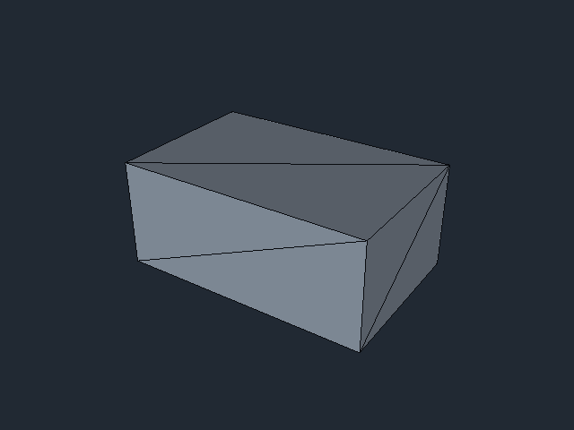
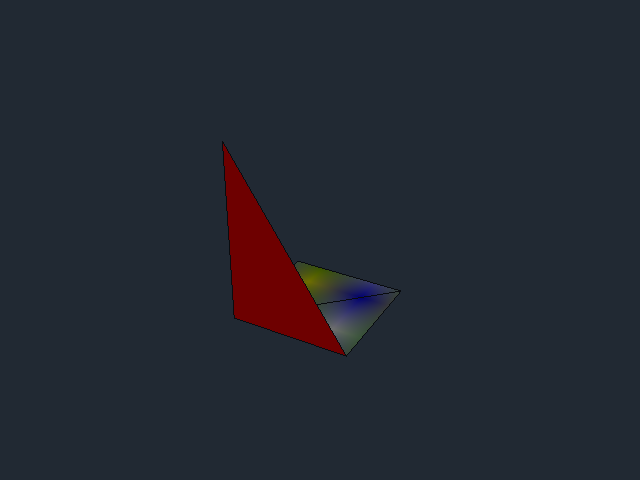

# 棱镜 3D · PrismView

一个轻量的 Windows STL / OBJ / PLY 三维模型查看器，使用 C++、Win32 和 OpenSceneGraph 构建。

支持在同一个窗口中打开和切换模型，以及实体、线框、实体与线框叠加三种显示模式。

## 下载使用

**[下载 Windows x64 便携版](https://github.com/yqlzhu910/PrismView/releases/latest)**

1. 在 Releases 中下载 `PrismView-v1.2.0-windows-x64.zip`。
2. 解压整个压缩包，进入 `PrismView` 文件夹。
3. 双击 `PrismView.exe`，点击“打开”选择模型，或把 STL / OBJ / PLY 拖进窗口。

程序包包含运行所需的 DLL 和模型读取插件，无需安装开发环境。请保留整个文件夹，不要只复制 EXE，也不要直接在压缩包内运行。可以将整个文件夹放到任意合适的位置，然后为 EXE 创建桌面快捷方式。

GitHub 自动生成的 `Source code` 压缩包只包含源码；直接使用请下载上面的 Windows 便携包。

## 功能

- 读取二进制 STL、文本 STL 和 OBJ 多边形模型。
- 读取 ASCII、小端和大端二进制 PLY，保留顶点颜色、坐标方向和已有法线；支持三角形、四边形网格及点云。
- 每次只打开主动选择的模型，不自动扫描同目录文件；左侧记录本次打开过的文件。
- 通过列表、上一个 / 下一个按钮切换模型。内存充足时保留当前和上一个模型，再次切换直接复用已准备好的显卡数据。`F5` 强制重读，适合文件、材质或贴图修改后刷新。
- 实体、线框、实体＋线框叠加三种显示模式，切换模型时保持所选模式。
- OBJ 支持 MTL 材质及 PNG、JPEG、BMP、TGA 贴图。
- 支持中文模型路径；OBJ 的 MTL 和贴图需要保留原有相对目录结构。
- 后台读取、加载进度、取消加载；读取失败或取消时保留当前模型。
- 显示三角形数量或点云点数，以及实际 OpenGL 渲染设备名称；使用 GPU 顶点缓冲绘制。
- 只读查看，不修改模型文件，也不更改系统默认打开方式。

### 实体＋线框渲染示例



### OBJ 材质与贴图叠加示例



以上图片由测试模型离屏渲染生成，展示渲染效果。

## 操作

| 操作 | 鼠标 / 快捷键 |
| --- | --- |
| 打开模型 | `Ctrl+O`，或拖入文件 |
| 旋转 | 鼠标左键拖动 |
| 平移 | 鼠标中键拖动 |
| 缩放 | 滚轮 |
| 视角复位 | 空格 |
| 切换显示模式 | `W`：实体 → 线框 → 实体＋线框 |
| 切换已打开的模型 | `PgUp` / `PgDn` |
| 重新读取当前文件 | `F5` |

只有点、没有面的 PLY 按点云显示，此时显示模式按钮标注“点云”，`W` 不切换模式；重新打开网格后恢复此前的网格显示模式。PLY 中超过四个顶点的面请先三角化再导入。

## 大模型说明

本次更新加快了大型文本 STL 的导入。查看器按块读取坐标，复用重复坐标的解析结果，并按原始顶点顺序构建完整网格。

打开较大的 STL、OBJ 和常见小端二进制 PLY 时，窗口会先显示抽样轮廓，后台读取完成后自动显示完整模型。状态栏会标明当前进度。取消或读取失败时恢复上一个完整模型。其他 PLY 布局在解析完成后显示。

切回最近查看的模型时，程序核对文件大小和最后修改时间。文件有变动、内存不足或模型已被移出缓存时会重新读取。OBJ 的外部材质或贴图单独修改后，请按 `F5`。

带 XYZ、RGBA、顶点法线的小端二进制 PLY 三角网格在匹配常见导出布局时按块读取，读取中可以取消。其他布局交给原 OSG 插件，以保留材质和自动生成法线的效果。插件解析期间取消或切换文件，需要等待当前解析结束。

模型加载完成后，旋转、平移和缩放时始终绘制完整网格或全部点云。

## 从源码构建

当前构建脚本对应以下环境：

- Windows x64。
- Visual Studio 2012 C++ 工具链（v110）。
- Windows SDK 8.1 的 UM / shared 头文件和 x64 库。
- 使用相同工具链构建的 OpenSceneGraph 3.4.0 x64 SDK，包括 OBJ、STL、PLY、图像插件及其依赖。

在仓库根目录运行 PowerShell，按实际 SDK 路径调整参数：

```powershell
& .\outputs\STLQuickView\source\build.ps1 `
  -OsgRoot 'D:\OSG(x64)\OSG(x64)' `
  -VcRoot 'C:\Program Files (x86)\Microsoft Visual Studio 11.0\VC'
```

脚本在 `work/build` 编译，并将程序及运行依赖复制到 `outputs/STLQuickView`。该 OSG SDK 使用 VC110 ABI，不能直接与其他不兼容工具链的 OSG 二进制混用。

构建完成后，生成带完整运行依赖的便携包：

```powershell
& .\package.ps1 -Version '1.2.0'
```

输出为 `dist/PrismView-v1.2.0-windows-x64.zip` 及对应 SHA-256 校验文件。源码目录和本机构建产物保留原有 `STLQuickView` 名称，便于兼容已有安装；发布包入口为 `PrismView.exe`。

## 目录

```text
outputs/STLQuickView/
  source/          Win32 界面、STL / OBJ / PLY 读取器和构建脚本
  assets/          程序图标
  licenses/        随运行包提供的第三方许可文本
  使用说明.txt
  THIRD_PARTY_NOTICES.md
docs/              渲染示例图片
tests/             PLY 样例生成、读取和离屏渲染测试
```

可执行文件、DLL、编译产物和个人测试模型不放入 Git 历史；完整运行包在 Releases 下载。

## 验证

发布前验证包含：本机编译、STL / OBJ / PLY 读取、中文路径、OBJ 负索引与凹多边形、材质和 PNG / JPEG 贴图、加载取消，以及三种显示模式的离屏渲染。叠加模式验证了遮挡关系和切回实体后的画面恢复。PLY 额外覆盖 ASCII、两种二进制字节序、颜色、法线、额外面属性、点云和网格之间切换，以及取消后保留当前模型。

构建后运行可重复的 PLY 测试（仅使用脚本生成的合成模型）：

```powershell
& .\tests\test-ply.ps1
# 加上 -Render 验证真实 OpenGL 离屏渲染，需要可用的图形设备。
& .\tests\test-ply.ps1 -Render
# 可选：-SamplePly '完整文件路径' 或 -RuntimeDirectory '解压后的 PrismView 目录'
```

离屏测试复用了程序的读取、GPU 数据准备、状态更新和显示模式代码；它不等同于手工操作文件选择对话框的验收。

## 第三方组件

程序使用 OpenSceneGraph / OpenThreads、libpng、zlib、Independent JPEG Group 代码及 Microsoft Visual C++ 2012 Runtime。版权和许可说明见 [THIRD_PARTY_NOTICES.md](outputs/STLQuickView/THIRD_PARTY_NOTICES.md)。第三方组件的许可证不改变本项目其他文件的许可状态。
